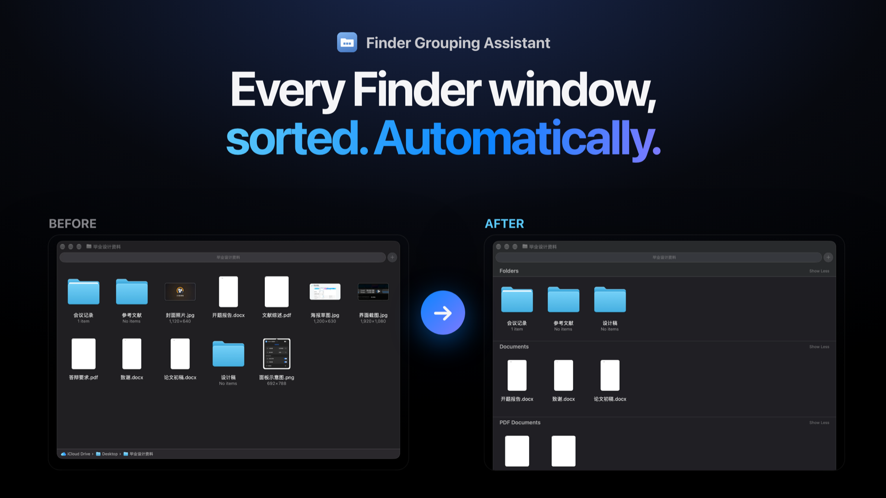
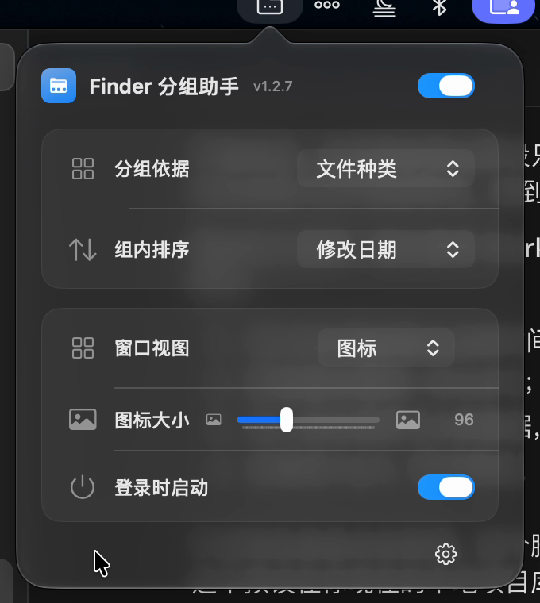

# Finder Grouping Assistant

**English** · [简体中文](README.zh-CN.md)

A tiny menu bar app that makes every Finder window use the grouping and sorting you choose — by Kind, Date, Size and more — automatically, every time you open a folder.





## Download

**[Download the latest version](https://github.com/myyccccc/Finder-Grouping-Assistant/releases/latest/download/FinderGroupingAssistant.dmg)** — free. Signed with Developer ID and notarized by Apple. macOS 13 or later, Apple silicon and Intel.

1. Open the DMG and drag the app to Applications.
2. Click the folder icon in the menu bar (on newer macOS it may be inside the `•••` menu bar overflow).
3. Allow Accessibility and Automation when asked.

## What it does

- Group by and sort within groups, applied to every Finder window, on internal and external drives.
- Window view (icon / list / columns) and icon size.
- Groups in icon view are expanded automatically.
- Optional: always keep hidden files hidden.
- Never moves, renames or deletes files. Everything stays on your Mac; the only network request is the update check.

## Build

```sh
FINDER_SIGN_IDENTITY='Developer ID Application: …' ./build.sh /path/to/output
```

`build.sh` builds a universal binary and runs the built-in self-tests. Without `FINDER_SIGN_IDENTITY` it signs ad hoc.

## License

MIT
