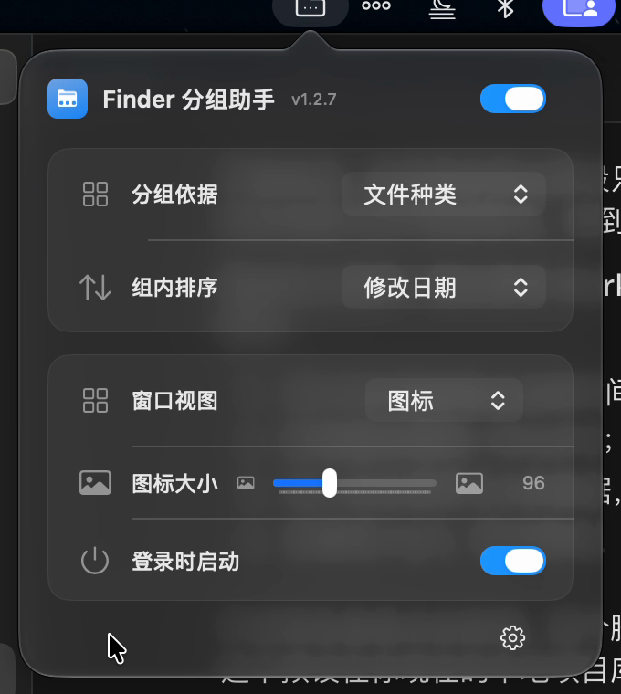

# Finder 分组助手

[English](README.md) · **简体中文**

一个很小的菜单栏工具：让每个 Finder 窗口自动使用你选的分组和排序（种类、日期、大小等），每次打开文件夹都生效。



## 下载

**[下载最新版](https://github.com/myyccccc/Finder-Grouping-Assistant/releases/latest/download/FinderGroupingAssistant.dmg)**，免费。已用 Developer ID 签名并通过 Apple 公证。需要 macOS 13 或更新版本，支持 Apple 芯片和 Intel。

1. 打开 DMG，把 App 拖进「应用程序」。
2. 点菜单栏的文件夹图标（新版 macOS 可能收在菜单栏的 `•••` 里）。
3. 按提示允许「辅助功能」和「自动化」。

## 功能

- 分组依据、组内排序，应用到所有 Finder 窗口（本机和外接设备）。
- 窗口视图（图标 / 列表 / 分栏）和图标大小。
- 图标视图里的分组自动展开。
- 可选：始终不显示隐藏文件。
- 不移动、不改名、不删除任何文件。数据只存在本机，唯一的网络请求是检查更新。

## 构建

```sh
FINDER_SIGN_IDENTITY='Developer ID Application: …' ./build.sh /path/to/output
```

## 许可

MIT
